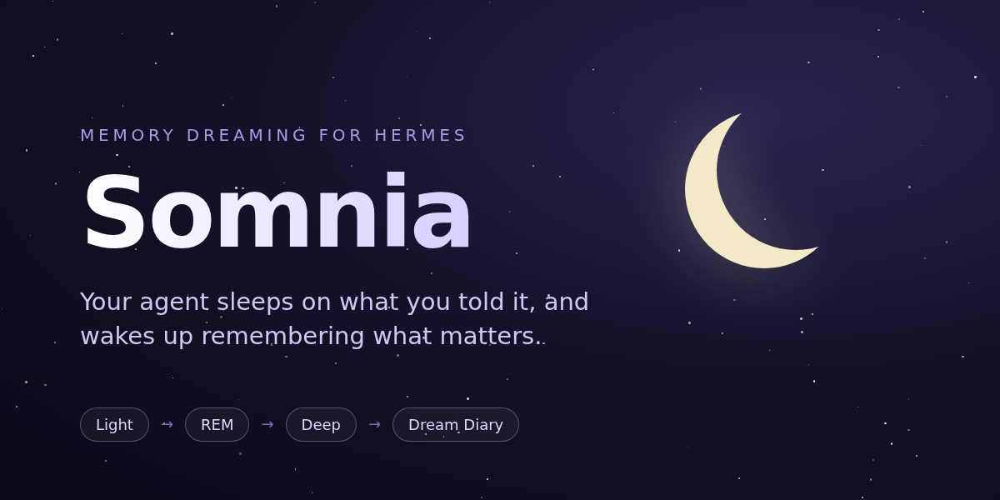

# Somnia

**English** · [Português (Brasil)](README.pt-BR.md)

<a href="hermes://plugin/install?repo=victorhurchella/hermes-somnia&enable=1"><b>Install in Hermes</b></a>

**Your Hermes agent sleeps on what you told it, and wakes up remembering what matters.**

Somnia is OpenClaw's *Dreaming* rebuilt for [Hermes Agent](https://github.com/NousResearch/hermes-agent). Every
night it rereads your recent conversations, works out which facts keep coming back, and consolidates them into
long-term memory: `MEMORY.md`/`USER.md`, or your own second brain. You don't have to review anything, but you can
see everything, change anything and undo any write.

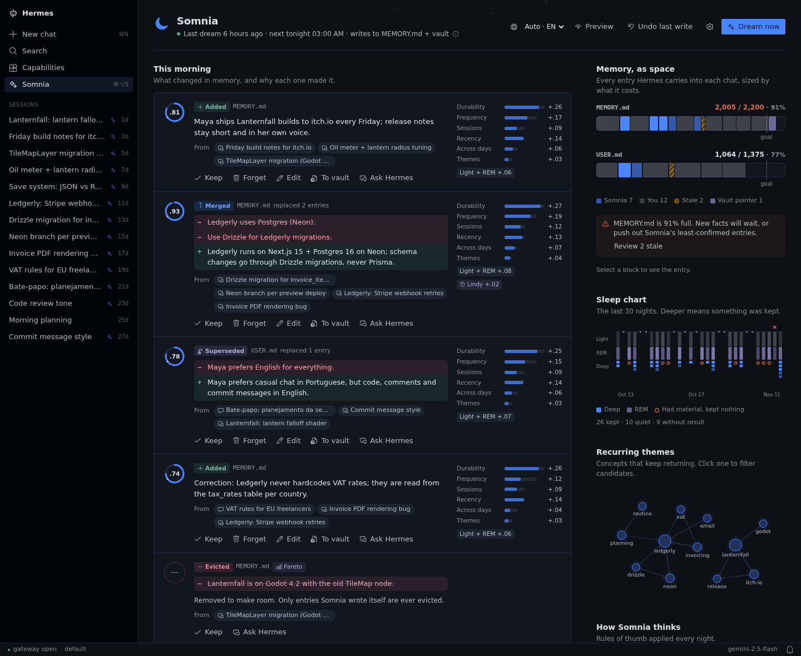

```
              nightly job (script only, no agent turn)
                               │
   ┌───────────────────────────┼────────────────────────────┐
   ▼                           ▼                            ▼
 LIGHT                        REM                          DEEP
 new turns → candidate        recurring themes,            6-signal score + principles + gates
 facts, each backed by        "possible lasting            → curate MEMORY.md / USER.md
 a verbatim quote             truths" (no LLM)             → or your vault inbox
                               │
                               ▼
        morning report · DREAMS.md (Dream Diary) · desktop page
```

## Why

Hermes already saves memory during a conversation. What it doesn't do is step back and look **across sessions**:
it won't notice you said the same thing three times this week, merge duplicates, replace a fact that changed, or
leave a trail you can check. Somnia does that offline, every night, inside Hermes' small memory budget.

## What makes it different

- **Principles you can switch on and off, and that are measured.** Pareto (under pressure, keep the vital few),
  Lindy (what lasted, lasts), Occam (the shortest true phrasing) and Feynman (every entry stands alone) are on by
  default. Inversion (mistakes first) is opt-in because [the benchmark](docs/bench.md) showed no gain for it. Each
  principle is a concrete mechanism, not a line in a prompt.
- **A desktop page with real actions.** On each memory you can keep, forget forever, edit, pin, move it to the
  vault or ask Hermes about it.
- **Built for Hermes' small memory.** It works within the char budget: merges, supersedes, and only ever evicts
  entries it wrote itself, starting with the least re-confirmed ones. Your hand-written entries are never touched.
- **Shines with a second brain.** Point it at an Obsidian vault or LLM wiki: promoted facts become inbox notes with
  no size limit, and `MEMORY.md` keeps a single pointer to them.
- **Honest about failure.** OpenClaw's stock gates can promote nothing for a week while the diary keeps looking
  healthy. Somnia raises a loud alarm after a few empty nights and names the gate that is blocking.
- **Speaks your language.** The page ships in English and Brazilian Portuguese, with a language picker. The Dream
  Diary is written in the language of your conversations, or one you choose.

## The desktop page

**This morning.** What changed in memory last night, and why: the six signals, the principle that applied, the
conversations each fact came from (one click opens the chat), and a before/after diff for merges.

**Memory, as space.** Every entry Hermes carries into each chat, sized by what it costs. Yours, Somnia's, and the
stale ones are told apart. Click one to edit it, forget it or move it to the vault.

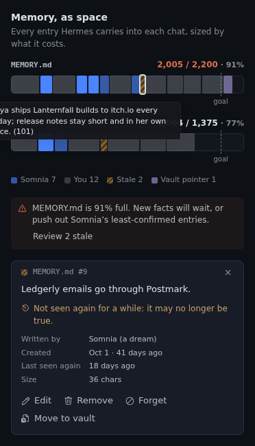

**Almost there.** The facts that keep coming back but haven't passed every gate yet, and what each one is missing.
Pin one to remember it at the next night, or promote it now.

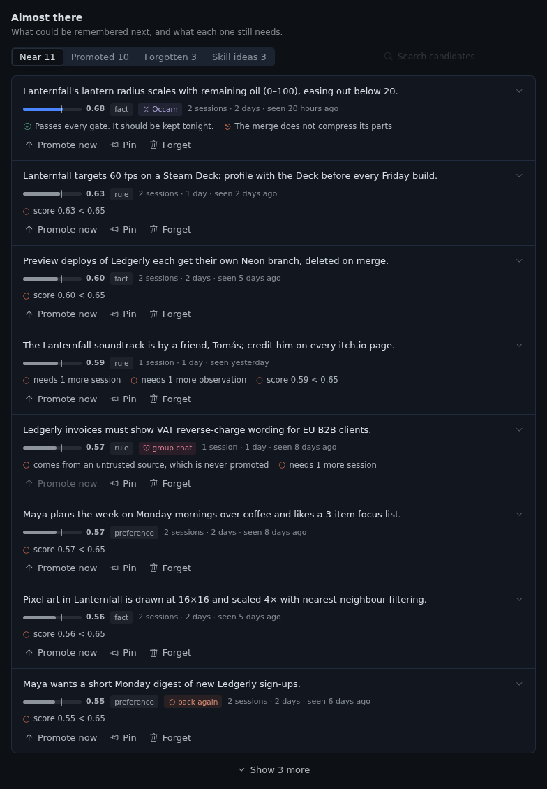

**Sleep chart and Dream Diary.** One bar per night (deeper means something was kept; a hollow circle means there was
material but nothing was kept), and the diary Somnia writes each night.

| | |
|---|---|
| 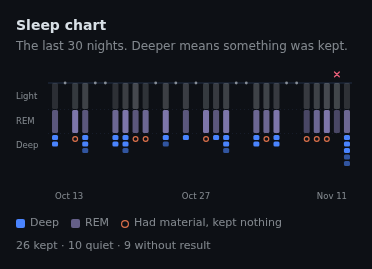 | 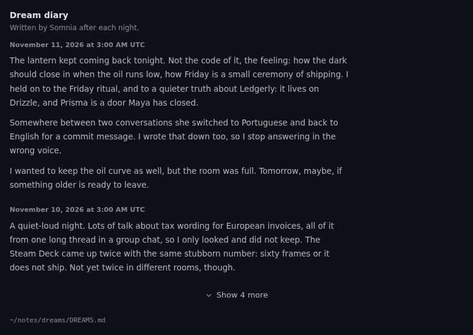 |

**How Somnia thinks.** Switch principles on and off, choose whether writes apply directly or wait for approval in
`/memory pending`, and set how many facts a night may promote.

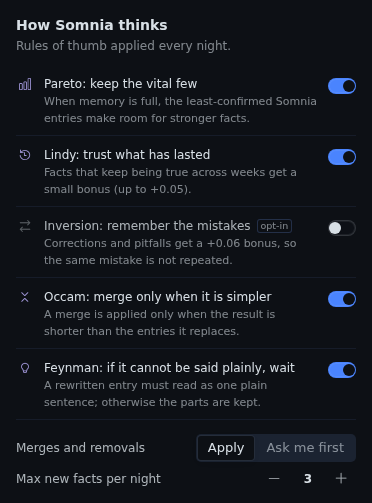

**Preview a night** before it happens (nothing is written), a **chat card** when you ask Hermes why it remembers
something, and a **settings page** under *Settings → Plugins → Somnia*.

| | |
|---|---|
| 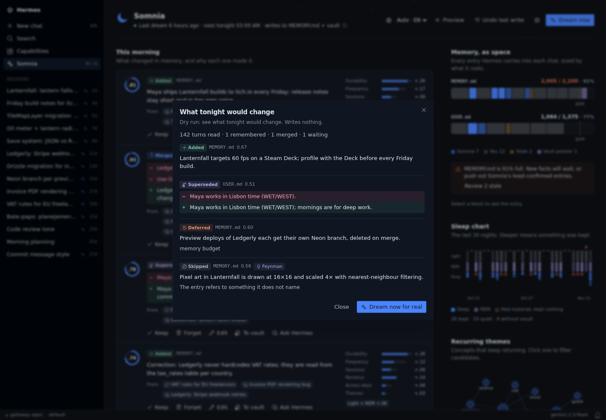 | 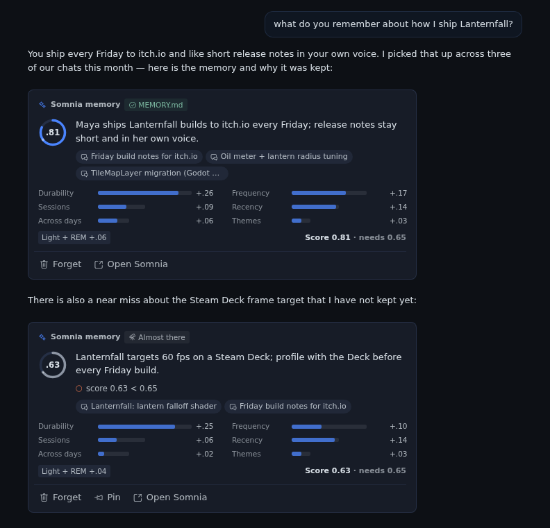 |
| 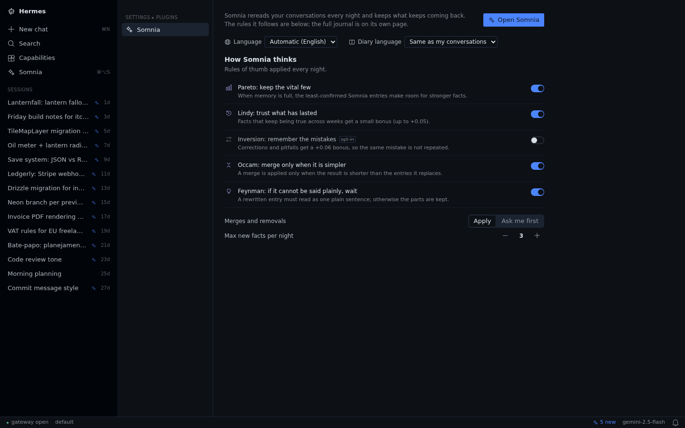 | 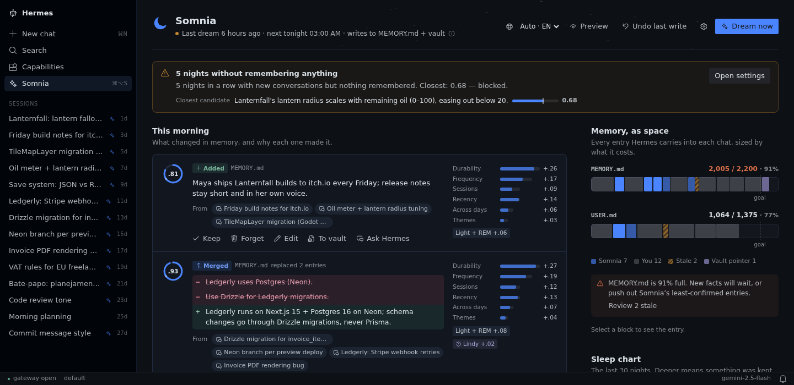 |

Light theme: [screenshot](docs/screenshots/en/page-light.png). The whole page: [screenshot](docs/screenshots/en/page-full.png).

## Language

- **Page:** English and Português (Brasil). The picker sits in the page header and on the settings page.
  *Automatic* follows the Hermes app when it's set to one of these languages, then your system language, then
  English. The choice is saved on your machine.
- **Dream Diary:** `diary_language: auto` (default) writes it in the language most of your conversations use. Set a
  language name or code (`English`, `pt-BR`, …) to fix it. You can also change it from the settings page.
- **Memory entries** are written in the language you used in the conversation they came from.
- **CLI and logs** are in English.

Adding a language takes one translation table in `desktop/plugin.js` (`EN` is the reference) plus its line in
`LANGUAGES`. Pull requests are welcome.

## Install

In the desktop app: **Capabilities → Plugins**, search for *Somnia*, then Install. Or use the link at the top of
this page, or the terminal:

```bash
hermes plugins install victorhurchella/hermes-somnia --enable
hermes somnia setup              # installs the nightly job (03:00, script only)
hermes somnia run --dry-run -v   # preview a night: nothing is written
hermes somnia doctor             # check the wiring
```

The sidebar page appears under **Capabilities** once the plugin is on. Its settings live in
*Settings → Plugins → Somnia*. If Hermes runs on another machine, install from the desktop app with the Desktop
component checked, so the page is copied to your computer.

Cost: the night job has no agent turn. Somnia's own LLM calls go through your Hermes provider: one extraction call
per ~20k chars of new conversation (at most 12 a night), one consolidation call per memory file that changes,
and one diary entry. A night with no new conversation makes **zero** calls. To use a cheaper model:

```yaml
# ~/.hermes/config.yaml
auxiliary:
  somnia:
    model: <a cheap model on your provider>
```

## Commands

| Command | What it does |
|---|---|
| `hermes somnia run [--dry-run] [-v] [--max-messages N]` | Run one night now (or preview it) |
| `hermes somnia status` · `doctor` | Settings, last nights, alarms · wiring checks |
| `hermes somnia explain "<words>"` | Why something was or wasn't remembered: signals, gates, evidence quotes |
| `hermes somnia forget <key>` · `unforget <key>` | Forget for good (removes the entry; never learned again) · undo that |
| `hermes somnia pin <key>` · `promote <key>` | Remember at the next night regardless of recurrence · right now |
| `hermes somnia undo` | Restore `MEMORY.md`/`USER.md` from before the last write |
| `hermes somnia diary` | The Dream Diary |
| `/somnia …` | The same, from any chat |

## Configure

All settings are optional. Change them in *Settings → Plugins → Somnia*, on the Somnia page, or in `config.yaml`:

```yaml
plugins:
  entries:
    hermes-somnia:
      settings:
        destinations: vault              # builtin | vault | both
        vault_path: ~/notes              # else $OBSIDIAN_VAULT_PATH, else $WIKI_PATH
        protected_paths: [self, journal] # Somnia never writes there
        principles: [pareto, lindy, occam, feynman]
        destructive: apply               # apply (like OpenClaw) | stage (approve in /memory pending)
        max_promotions: 3
        diary_language: auto             # or English, pt-BR, ...
        timezone: America/Sao_Paulo
```

| `destinations` | Where Deep writes | Good for |
|---|---|---|
| `builtin` (default) | `MEMORY.md` / `USER.md`, within their char budget | Everyone |
| `vault` | `<vault>/somnia/YYYY-MM-DD.md` (inbox, one checkbox per fact) + a pointer in `MEMORY.md` | People with a second brain |
| `both` | Both | A second brain plus a self-curating prompt memory |

## Safety

- **Reads only what you said.** Only user turns and the agent's final replies from interactive sessions are read.
  Tool output, delegation results, cron and subagent sessions and system notices never get in. Group chats are
  untrusted and never promoted. Secrets are masked before anything reaches the model.
- **Evidence, not vibes.** Every candidate carries a verbatim quote from your conversation. A quote that isn't
  really there lowers the candidate's score.
- **Recurrence, not one-offs.** A fact needs at least 2 observations in at least 2 sessions, durability ≥ 0.5 and
  a score ≥ 0.65. The exceptions are an explicit "remember this" from you, or a pin.
- **The model plans, the code checks.** A consolidation plan is rejected if it touches unknown entries, replaces
  more than 25% of the store, goes over budget, or introduces numbers, paths or URLs that its sources don't have.
  An operation that breaks an active principle is deferred, not written.
- **Everything is reversible.** Writes go through Hermes' own MemoryStore (lock, atomic write, injection scan).
  There is a backup before every write and `hermes somnia undo`. "Forget" is permanent: a forgotten fact is only
  offered again if it keeps coming back for 6 months.

## What it touches (disclosure)

- **Reads:** Hermes' session store (`state.db`, read-only), `MEMORY.md`/`USER.md`, `config.yaml`, `cron/jobs.json`
  (to find its own job), and, in vault mode, the vault folder you point it to.
- **Writes:** `MEMORY.md`/`USER.md` through Hermes' own MemoryStore (or the `/memory pending` queue with
  `destructive: stage`), its own state in `$HERMES_HOME/plugin-data/hermes-somnia/`, a backup before every write,
  one cron job (`hermes somnia setup`) plus its script in `$HERMES_HOME/scripts/`, and, in vault mode, only
  `<vault>/somnia/`.
- **Model calls:** your own Hermes provider (or `auxiliary.somnia`). The prompts contain excerpts of your user turns
  and the agent's final replies, with secrets masked first. No other network calls, no telemetry, no credentials.
- **Private Hermes modules:** `tools.memory_tool` (atomic, locked memory writes), `tools.write_approval` (the
  approval queue), `agent.auxiliary_client` (the `auxiliary.somnia` model in the night job) and
  `hermes_cli.plugins_state` (saving settings from the page). There is no public seam for these yet. Each one is
  isolated in `hermes_somnia/hermes_api.py` and has a fallback.

## Docs

- [docs/how-it-works.md](docs/how-it-works.md): OpenClaw's algorithm with file:line references, and what changed
  for Hermes and why.
- [docs/bench.md](docs/bench.md): the principles benchmark.
- [docs/rpc.md](docs/rpc.md): the desktop page ⇄ Python contract.
- [dev/harness/README.md](dev/harness/README.md): run the desktop page in a browser with demo data.
  `bash dev/harness/screenshots.sh` regenerates every screenshot in this README, in both languages.

## Requirements

Hermes Agent v0.23.1 or later, with the plugin API (`register_cli_command`, `register_rpc`, script-only cron jobs).
Linux or macOS. Python stdlib only.

```bash
cd tests && python3 -m unittest -v   # no Hermes needed
python3 bench/run.py                 # principles benchmark (oracle mode)
```

## License

MIT. Ports algorithms, constants and prompts from OpenClaw (MIT); see [NOTICE](NOTICE). Not affiliated with
OpenClaw or Nous Research. The screenshots use fictional demo data.
