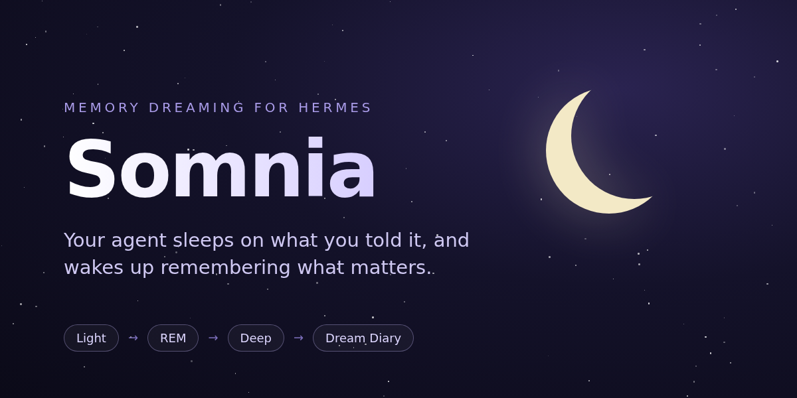

# Somnia

**English** · [Português (Brasil)](README.pt-BR.md)

[](https://github.com/victorhurchella/hermes-somnia/releases)
[](LICENSE)
[](https://github.com/NousResearch/hermes-agent)

<a href="hermes://plugin/install?repo=victorhurchella/hermes-somnia&enable=1"><b>Install in Hermes</b></a>

**Your Hermes agent sleeps on what you told it, and wakes up remembering what matters.**

Somnia is OpenClaw's *Dreaming* rebuilt for [Hermes Agent](https://github.com/NousResearch/hermes-agent). Every
night it rereads your recent conversations and looks for **how you judge**: the principles you reason with, what
you weigh above what, what makes you accept or reject work, and what you want from an answer. When the same
criterion shows up on two separate occasions, it proposes an **insight**, with your own words as evidence. The ones
you approve go into a note your agent reads before it works, and the few about its answers go into `USER.md`.

It can also do what OpenClaw does and remember the **facts** that keep coming back (`focus: facts`, or `both`).

> **Upgrading from 0.3?** The default changed from facts to insights. Nothing was deleted: set `focus: facts` (or
> `both`) in *Settings → Plugins → Somnia* to get the previous behaviour back.

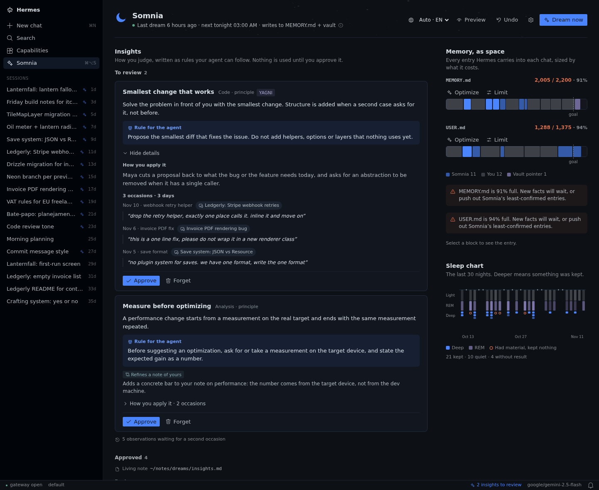

```
 focus: insights (default)

   new turns ──► observations ──► same criterion on 2+ days, ──► proposal ──► you approve ──► living note
   (your words)  (quote checked)   in 2+ sessions? (code)        (inbox)      (tick, page,     + USER.md
                                                                               or CLI)
   An empty night is the normal result. Nothing is written to memory without your approval.

 focus: facts

              nightly job (script only, no agent turn)
                               │
   ┌───────────────────────────┼────────────────────────────┐
   ▼                           ▼                            ▼
 LIGHT                        REM                          DEEP
 new turns → candidate        recurring themes,            6-signal score + principles + gates
 facts, each backed by        "possible lasting            → curate MEMORY.md / USER.md
 a verbatim quote             truths" (no LLM)             → or your vault inbox
                               │
                               ▼
        morning report · DREAMS.md (Dream Diary) · desktop page
```

## Why

Hermes already saves memory during a conversation. What it doesn't do is step back and look **across sessions**.
It won't notice that you rejected three designs this month for the same reason, or that you asked for "the smallest
change" in two unrelated projects. Facts about a project already have a home (the repo, a skill, your notes). The
way you judge has none, and it is what makes an agent answer the way you would.

Somnia looks for that offline, every night. In facts mode it also notices that you said the same thing three times
this week, merges duplicates, replaces a fact that changed, and leaves a trail you can check, inside Hermes' small
memory budget.

## What makes it different

- **Insights, not filler.** An insight is a criterion you apply, how you apply it, the rule it implies for the
  agent, and the quotes behind it. It needs two occasions on different days in different sessions, with different
  sentences, and code checks that, not the model. There is no nightly quota: most nights propose nothing, and that
  is not an error.
- **Only your own words count.** A quote is evidence only when it is found verbatim in something you typed. Agent
  replies, and the briefs an agent writes for its subagents, are never evidence.
- **You approve, then it is used.** Tick the proposal in your vault, click Approve on the page, or run
  `hermes somnia approve <key>`. Approved insights live in one generated note, grouped by kind of work, and one
  line in `USER.md` tells the agent to read it. Forget one and it is never proposed again.
- **Principles you can switch on and off, and that are measured.** Pareto (under pressure, keep the vital few),
  Lindy (what lasted, lasts), Occam (the shortest true phrasing) and Feynman (every entry stands alone) are on by
  default. Inversion (mistakes first) is opt-in because [the benchmark](docs/bench.md) showed no gain for it. Each
  principle is a concrete mechanism, not a line in a prompt.
- **A desktop page with real actions.** On each memory you can keep, forget forever, edit, pin, move it to the
  vault or ask Hermes about it.
- **Built for Hermes' small memory.** It works within the char budget: merges, supersedes, and only ever evicts
  entries it wrote itself, starting with the least re-confirmed ones. Your hand-written entries are never touched.
- **Optimize when memory is full.** One click proposes a shorter `MEMORY.md`/`USER.md` with the same behaviour:
  rewrites that drop or invent a number, path, command or name are refused by code, a second model pass checks the
  agent would act the same, and you approve entry by entry. Or raise the limit and see what it costs in tokens.
- **Shines with a second brain.** If you have an Obsidian vault or LLM wiki configured, Somnia uses it by default:
  promoted facts become inbox notes with no size limit, in your vault's own frontmatter, and an optional command
  (a git commit + push, say) syncs them after each night.
- **Honest about failure.** OpenClaw's stock gates can promote nothing for a week while the diary keeps looking
  healthy. Somnia raises a loud alarm after a few empty nights and names the gate that is blocking.
- **Speaks your language.** The page ships in English and Brazilian Portuguese, with a language picker. The Dream
  Diary is written in the language of your conversations, or one you choose.

## The desktop page

**Insights.** What Somnia noticed about how you judge, waiting for your call: the criterion, the rule for the
agent, and each occasion with your quote and the chat it came from. Below, the insights you approved, by area.

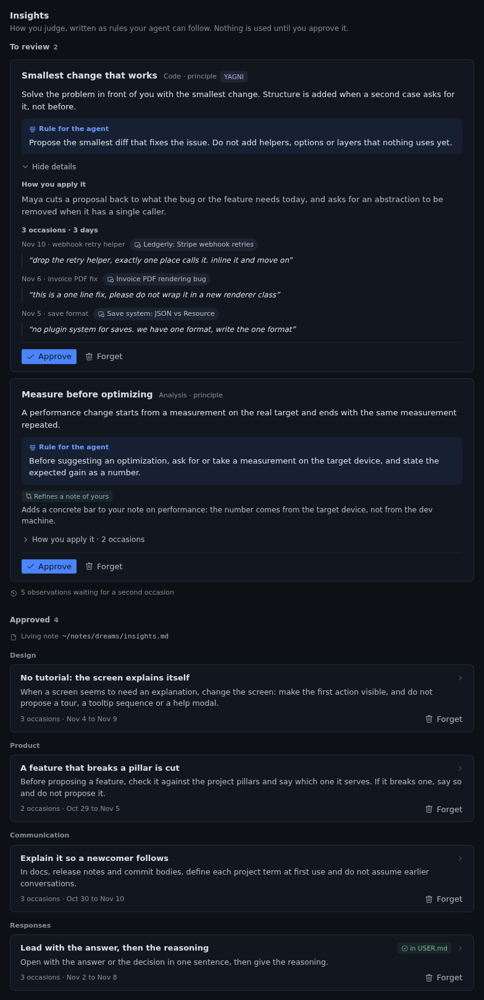

The sections below belong to facts mode (`focus: facts` or `both`); memory, the sleep chart and the diary are
always there.

**This morning.** What changed in memory last night, and why: the six signals, the principle that applied, the
conversations each fact came from (one click opens the chat), and a before/after diff for merges.

**Memory, as space.** Every entry Hermes carries into each chat, sized by what it costs. Yours, Somnia's, and the
stale ones are told apart. Click one to edit it, forget it or move it to the vault.

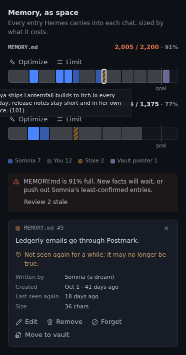

**Optimize** rewrites a full `MEMORY.md` or `USER.md` in fewer characters with the same behaviour. The model proposes
(shorten, or merge entries on the same subject); the code refuses any rewrite that drops or adds a number, path,
command, name or identifier; a second model pass checks the agent would act the same. You tick what to apply, there
is a backup, and *Undo* restores it. **Limit** raises Hermes' character budget for a file and shows what it costs in
tokens per chat. Both are also on the CLI: `hermes somnia optimize --target user`.

| | |
|---|---|
| 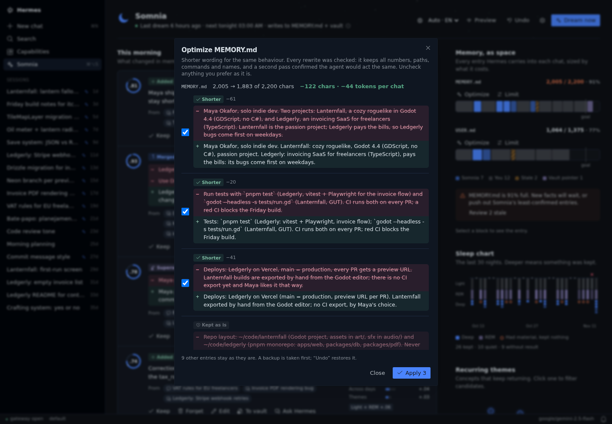 | 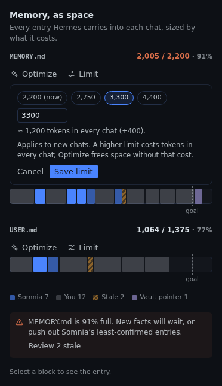 |

**Almost there.** The facts that keep coming back but haven't passed every gate yet, and what each one is missing.
Pin one to remember it at the next night, or promote it now.

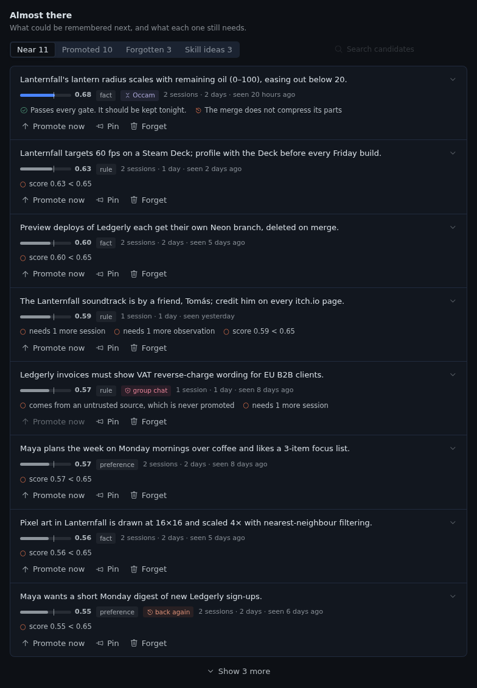

**Sleep chart and Dream Diary.** One bar per night (deeper means something was kept; a hollow circle means there was
material but nothing was kept), and the diary Somnia writes each night.

| | |
|---|---|
| 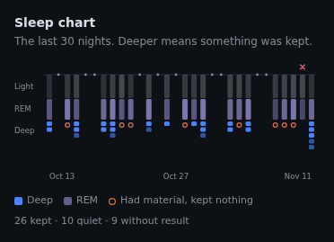 | 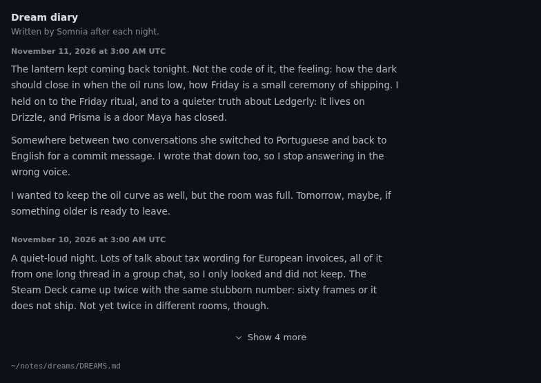 |

**How Somnia thinks.** Switch principles on and off, choose whether writes apply directly or wait for approval in
`/memory pending`, and set how many facts a night may promote.

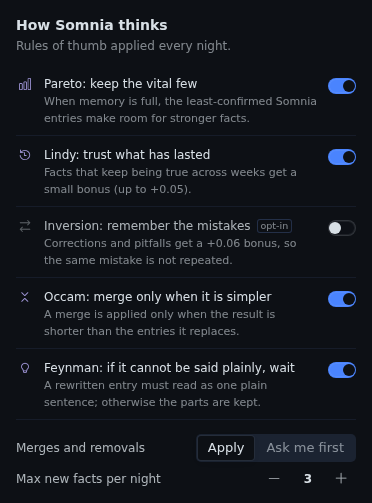

**Preview a night** before it happens (nothing is written; cancel it any time), a **chat card** when you ask Hermes why it remembers
something, and a **settings page** under *Settings → Plugins → Somnia*.

| | |
|---|---|
| 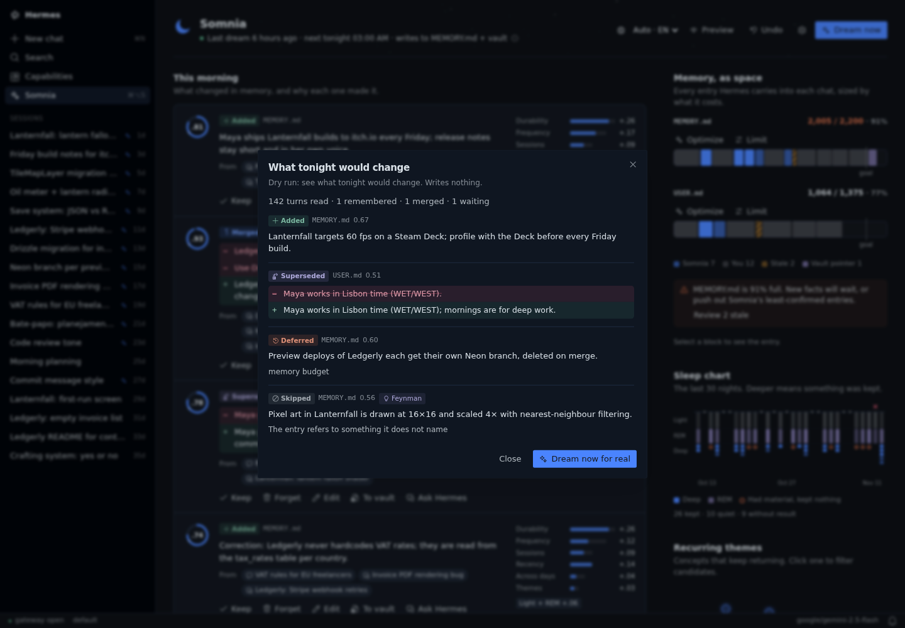 | 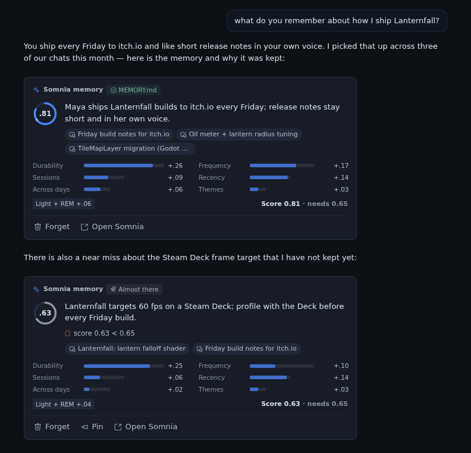 |
| 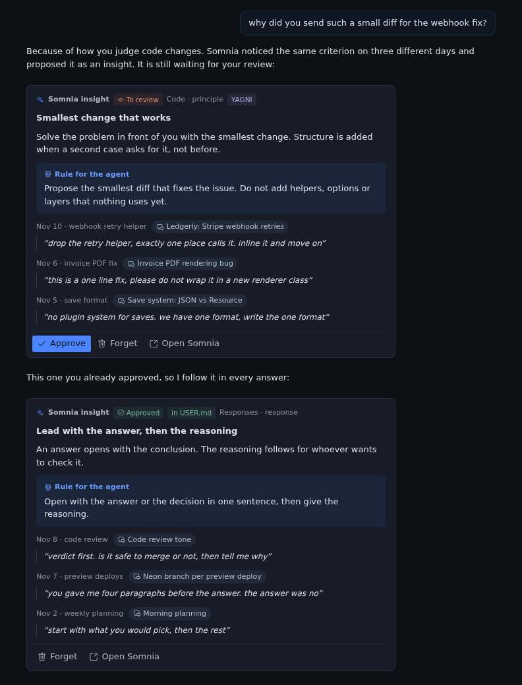 | |
| 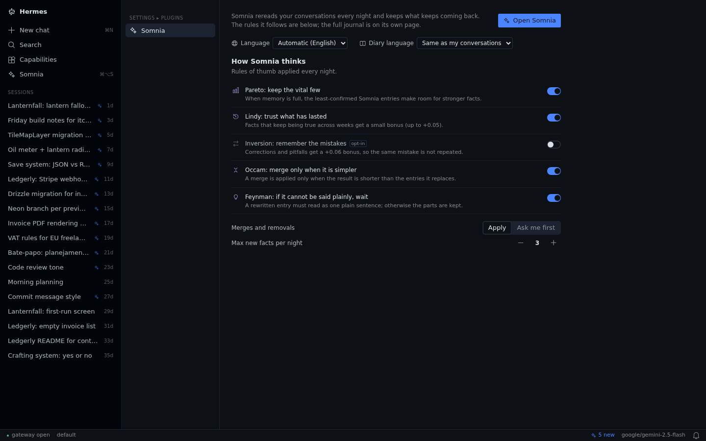 | 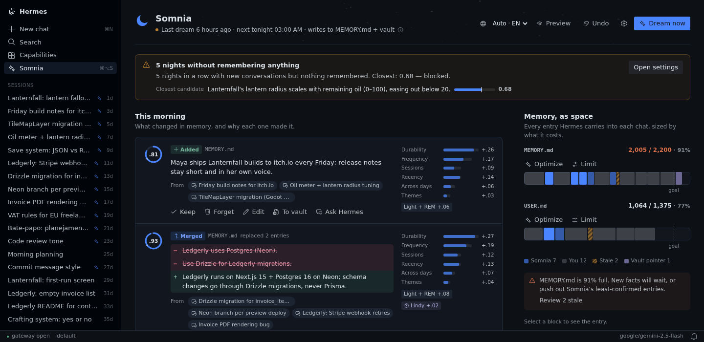 |

Light theme: [screenshot](docs/screenshots/en/page-light.png). The whole page: [screenshot](docs/screenshots/en/page-full.png).

## Language

- **Page:** English and Português (Brasil). The picker sits in the page header and on the settings page.
  *Automatic* follows the Hermes app when it's set to one of these languages, then your system language, then
  English. The choice is saved on your machine.
- **Dream Diary:** `diary_language: auto` (default) writes it in the language most of your conversations use. Set a
  language name or code (`English`, `pt-BR`, …) to fix it. You can also change it from the settings page.
- **Memory entries** are written in the language you used in the conversation they came from, or in the one set
  by `fact_language`.
- **CLI and logs** are in English.

Adding a language takes one translation table in `desktop/plugin.js` (`EN` is the reference) plus its line in
`LANGUAGES`. Pull requests are welcome.

## Install

In the desktop app: **Capabilities → Plugins**, search for *Somnia*, then Install. Or use the link at the top of
this page, or the terminal:

```bash
hermes plugins install victorhurchella/hermes-somnia --enable
hermes somnia setup              # installs the nightly job (03:00, script only)
hermes somnia run --dry-run -v   # preview a night: nothing is written
hermes somnia doctor             # check the wiring
```

The sidebar page appears under **Capabilities** once the plugin is on. Its settings live in
*Settings → Plugins → Somnia*. If Hermes runs on another machine, install from the desktop app with the Desktop
component checked, so the page is copied to your computer.

Cost: the night job has no agent turn. Somnia's own LLM calls go through your Hermes provider. With `focus:
insights`: one extraction call per ~40k chars of new conversation (at most 12 a night), one synthesis call on nights
that found something, and a diary entry only when an insight was proposed or approved. With `focus: facts`: one
extraction call per ~20k chars (at most 12), one consolidation call per memory file that changes, and one diary
entry. `both` adds the two. A night with no new conversation makes **zero** calls. To use a cheaper model:

```yaml
# ~/.hermes/config.yaml
auxiliary:
  somnia:
    model: <a cheap model on your provider>
```

## Commands

| Command | What it does |
|---|---|
| `hermes somnia run [--dry-run] [-v] [--max-messages N]` | Run one night now (or preview it) |
| `hermes somnia status` · `doctor` | Settings, last nights, alarms · wiring checks |
| `hermes somnia explain "<words>"` | Why something was or wasn't remembered: signals, gates, evidence quotes |
| `hermes somnia approve <key>` | Approve a proposed insight now (living note, pointer, `USER.md`) |
| `hermes somnia forget <key>` · `unforget <key>` | Forget a fact or an insight for good (removes what it wrote; never proposed again) · undo that |
| `hermes somnia pin <key>` · `promote <key>` | Remember at the next night regardless of recurrence · right now |
| `hermes somnia optimize [--target user] [--apply]` | Propose a shorter `MEMORY.md`/`USER.md` that keeps every instruction (2 model calls; `--apply` writes the checked rewrites) |
| `hermes somnia undo` | Restore `MEMORY.md`/`USER.md` from before the last write (a night or an Optimize) |
| `hermes somnia diary` | The Dream Diary |
| `/somnia …` | The same, from any chat |

## Configure

All settings are optional. Change them in *Settings → Plugins → Somnia*, on the Somnia page, or in `config.yaml`:

```yaml
plugins:
  entries:
    hermes-somnia:
      settings:
        focus: insights                  # insights | facts | both
        insights_note: ""                # vault-relative path of the living note; empty = <vault_folder>/insights.md
        insights_known_notes: []         # notes where your principles are already written (read only)
        insights_pointer: true           # one USER.md entry pointing at the living note
        insights_inline_max: 3           # most insights about the agent's answers copied into USER.md
        max_insights: 3                  # most new proposals per night (no minimum)
        vault_pull_command: ""           # e.g. git pull, run before ticked proposals are read
        destinations: auto               # auto | builtin | vault | both
        vault_path: ~/notes              # else $OBSIDIAN_VAULT_PATH, else $WIKI_PATH
        protected_paths: [self, journal] # Somnia never writes there
        vault_note_type: inbox           # frontmatter of the inbox notes, to match your vault's schema
        vault_note_tags: [somnia]
        vault_language: en               # en | pt-BR: headings of the inbox notes
        vault_sync_command: ""           # e.g. git commit + push after each night ({note} {folder} {day})
        fact_language: auto              # or English, pt-BR, ...: the language remembered facts are written in
        principles: [pareto, lindy, occam, feynman]
        destructive: apply               # apply (like OpenClaw) | stage (approve in /memory pending)
        max_promotions: 3
        diary_language: auto             # or English, pt-BR, ...
        timezone: America/Sao_Paulo
```

| `destinations` | Where Deep writes | Good for |
|---|---|---|
| `auto` (default) | The vault when one is configured (`vault_path`, `$OBSIDIAN_VAULT_PATH` or `$WIKI_PATH`), else `builtin` | Everyone |
| `builtin` | `MEMORY.md` / `USER.md`, within their char budget | Prompt memory only |
| `vault` | `<vault>/somnia/YYYY-MM-DD.md` (inbox, one checkbox per fact) + a pointer in `MEMORY.md` | People with a second brain |
| `both` | Both | A second brain plus a self-curating prompt memory |

### Where insights go

- **Proposals** are appended to the night's inbox note (`<vault>/somnia/YYYY-MM-DD.md`) under `### Insights`, one
  checkbox each. Ticking the box approves it at the next sweep (set `vault_pull_command` if you tick on another
  device). Without a vault, proposals live on the desktop page and in the morning report.
- **The living note** (`insights_note`) holds the approved ones, grouped by area (design, product, analysis, code,
  communication, responses). Somnia generates this file and rewrites it on every change, so don't edit it. You may
  point it anywhere in your vault, even at a protected folder; Somnia refuses a file it did not create.
- **`USER.md`** gets one pointer entry, plus up to three approved insights about the agent's answers as one-line
  rules. These are additions only: if `USER.md` is full, the approval still stands and you get a warning.
- **`insights_known_notes`** lists notes where you already wrote your principles. Somnia reads them so it can say
  whether an insight is new, refines one of yours, or is already recorded (then it is not proposed).

## Safety

- **Reads only what you said.** Only user turns and the agent's final replies from interactive sessions are read.
  Tool output, delegation results, cron and subagent sessions (including subagents that inherit an interactive
  source) and system notices never get in. Group chats are
  untrusted and never promoted. Secrets are masked before anything reaches the model.
- **Evidence, not vibes.** Every candidate carries a verbatim quote from your conversation. A quote that isn't
  really there lowers the candidate's score.
- **Insights need two occasions and your approval.** Two sessions, two days, two different sentences, each quote
  found in your own turns. Nothing reaches the living note or `USER.md` before you approve it. `hermes somnia undo`
  does not cover insights: take one back with `forget`.
- **Recurrence, not one-offs.** A fact needs at least 2 observations in at least 2 sessions, durability ≥ 0.5 and
  a score ≥ 0.65. The exceptions are an explicit "remember this" from you, or a pin.
- **The model plans, the code checks.** A consolidation plan is rejected if it touches unknown entries, replaces
  more than 25% of the store, goes over budget, or introduces numbers, paths or URLs that its sources don't have.
  An operation that breaks an active principle is deferred, not written.
- **Everything is reversible.** Writes go through Hermes' own MemoryStore (lock, atomic write, injection scan).
  There is a backup before every write and `hermes somnia undo`. "Forget" is permanent: a forgotten fact is only
  offered again if it keeps coming back for 6 months.

## What it touches (disclosure)

- **Reads:** Hermes' session store (`state.db`, read-only), `MEMORY.md`/`USER.md`, `config.yaml`, `cron/jobs.json`
  (to find its own job), and, in vault mode, the vault folder you point it to and the notes listed in
  `insights_known_notes`.
- **Writes:** `MEMORY.md`/`USER.md` through Hermes' own MemoryStore (or the `/memory pending` queue with
  `destructive: stage`), its own state in `$HERMES_HOME/plugin-data/hermes-somnia/`, a backup before every write,
  one cron job (`hermes somnia setup`) plus its script in `$HERMES_HOME/scripts/`, and, in vault mode, only
  `<vault>/somnia/` plus the one `insights_note` file if you moved it elsewhere in the vault. It runs
  `vault_pull_command` and `vault_sync_command` from the vault root when you set them. When you change a **Limit** on the page, `memory.memory_char_limit` /
  `memory.user_char_limit` in `config.yaml`, through `hermes config set`.
- **Model calls:** your own Hermes provider (or `auxiliary.somnia`). The prompts contain excerpts of your user turns
  and the agent's final replies, with secrets masked first. No other network calls, no telemetry, no credentials.
- **Private Hermes modules:** `tools.memory_tool` (atomic, locked memory writes), `tools.write_approval` (the
  approval queue), `agent.auxiliary_client` (the `auxiliary.somnia` model in the night job) and
  `hermes_cli.plugins_state` (saving settings from the page). There is no public seam for these yet. Each one is
  isolated in `hermes_somnia/hermes_api.py` and has a fallback.

## Docs

- [docs/how-it-works.md](docs/how-it-works.md): OpenClaw's algorithm with file:line references, and what changed
  for Hermes and why.
- [docs/bench.md](docs/bench.md): the principles benchmark.
- [docs/rpc.md](docs/rpc.md): the desktop page ⇄ Python contract.
- [dev/harness/README.md](dev/harness/README.md): run the desktop page in a browser with demo data.
  `bash dev/harness/screenshots.sh` regenerates every screenshot in this README, in both languages.

## Requirements

Hermes Agent v0.23.1 or later, with the plugin API (`register_cli_command`, `register_rpc`, script-only cron jobs).
Linux or macOS. Python stdlib only.

```bash
cd tests && python3 -m unittest -v   # no Hermes needed
python3 bench/run.py                 # principles benchmark (oracle mode)
```

## License

MIT. Ports algorithms, constants and prompts from OpenClaw (MIT); see [NOTICE](NOTICE). Not affiliated with
OpenClaw or Nous Research. The screenshots use fictional demo data.
