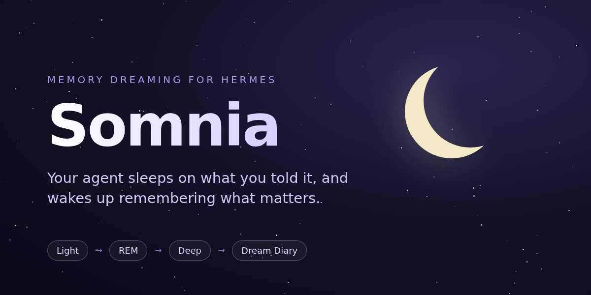

# Somnia

[English](README.md) · **Português (Brasil)**

[](https://github.com/victorhurchella/hermes-somnia/releases)
[](LICENSE)
[](https://github.com/NousResearch/hermes-agent)

<a href="hermes://plugin/install?repo=victorhurchella/hermes-somnia&enable=1"><b>Instalar no Hermes</b></a>

**Seu agente Hermes dorme sobre o que você contou e acorda lembrando do que importa.**

O Somnia é o *Dreaming* do OpenClaw refeito para o [Hermes Agent](https://github.com/NousResearch/hermes-agent).
Toda noite ele relê suas conversas recentes, descobre quais fatos continuam voltando e os consolida na memória de
longo prazo: `MEMORY.md`/`USER.md` ou o seu próprio second brain. Você não precisa revisar nada, mas pode ver tudo,
mudar qualquer coisa e desfazer qualquer gravação.

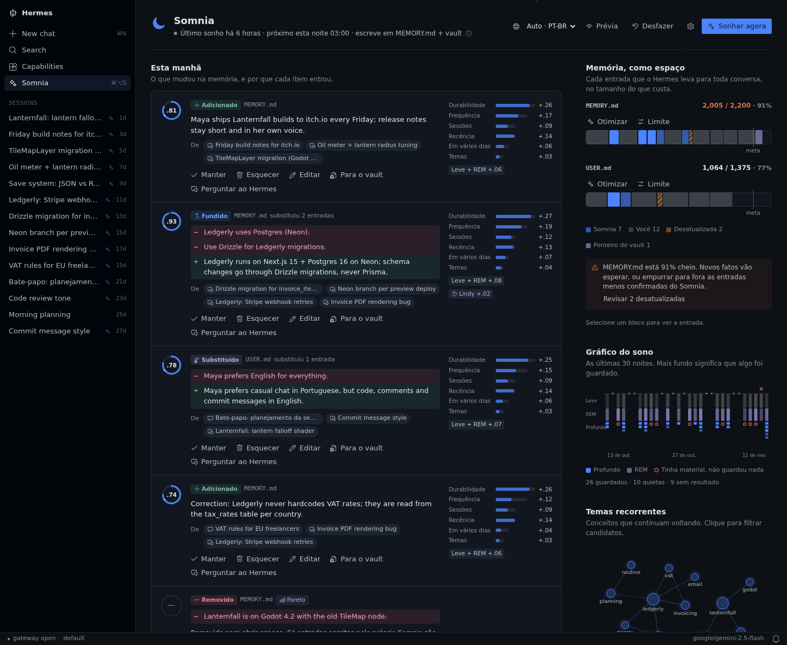

```
           job noturno (só script, sem turno de agente)
                               │
   ┌───────────────────────────┼────────────────────────────┐
   ▼                           ▼                            ▼
 LEVE                         REM                          PROFUNDO
 mensagens novas → fatos      temas recorrentes,           nota com 6 sinais + princípios + filtros
 candidatos, cada um com      "possíveis verdades          → cuida do MEMORY.md / USER.md
 uma citação literal          duradouras" (sem LLM)        → ou do inbox do seu vault
                               │
                               ▼
        relatório da manhã · DREAMS.md (Diário de sonhos) · página no desktop
```

## Por quê

O Hermes já salva memória durante a conversa. O que ele não faz é olhar **entre as sessões**: não percebe que você
disse a mesma coisa três vezes na semana, não junta duplicatas, não troca um fato que mudou e não deixa um rastro
que dê para conferir. O Somnia faz isso offline, toda noite, dentro do pequeno orçamento de memória do Hermes.

## O que ele tem de diferente

- **Princípios que você liga e desliga, e que foram medidos.** Pareto (sob pressão, fica o pouco que é vital),
  Lindy (o que durou, dura), Occam (a frase verdadeira mais curta) e Feynman (cada entrada se explica sozinha) vêm
  ligados. Inversão (erros primeiro) é opcional, porque [o benchmark](docs/bench.md) não mostrou ganho com ela.
  Cada princípio é um mecanismo de verdade, não uma linha no prompt.
- **Uma página no desktop com ações de verdade.** Em cada memória você pode manter, esquecer para sempre, editar,
  fixar, mover para o vault ou perguntar ao Hermes sobre ela.
- **Feito para a memória pequena do Hermes.** Trabalha dentro do limite de caracteres: junta, substitui e só remove
  entradas que ele mesmo escreveu, começando pelas menos confirmadas. As entradas que você escreveu nunca são tocadas.
- **Otimizar quando a memória enche.** Um clique propõe um `MEMORY.md`/`USER.md` mais curto com o mesmo
  comportamento: o código recusa reescritas que percam ou inventem número, caminho, comando ou nome, uma segunda
  leitura do modelo confere se o agente agiria igual, e você aprova entrada por entrada. Ou aumente o limite e veja
  quanto isso custa em tokens.
- **Brilha com um second brain.** Se você tem um vault do Obsidian ou um LLM wiki configurado, o Somnia usa ele por
  padrão: os fatos promovidos viram notas no inbox, sem limite de tamanho, no frontmatter do seu vault, e um comando
  opcional (um git commit + push, por exemplo) sincroniza depois de cada noite.
- **Honesto quando falha.** Os filtros padrão do OpenClaw podem passar uma semana sem promover nada enquanto o
  diário parece saudável. O Somnia dispara um alarme depois de algumas noites vazias e diz qual filtro está barrando.
- **Fala a sua língua.** A página vem em inglês e português do Brasil, com seletor de idioma. O Diário de sonhos é
  escrito no idioma das suas conversas, ou no que você escolher.

## A página no desktop

**Esta manhã.** O que mudou na memória na última noite, e por quê: os seis sinais, o princípio que se aplicou, as
conversas de onde cada fato saiu (um clique abre o chat) e o antes/depois quando houve fusão.

**Memória, como espaço.** Cada entrada que o Hermes carrega em toda conversa, do tamanho do que ela custa. As suas,
as do Somnia e as vencidas aparecem separadas. Clique numa para editar, esquecer ou mover para o vault.

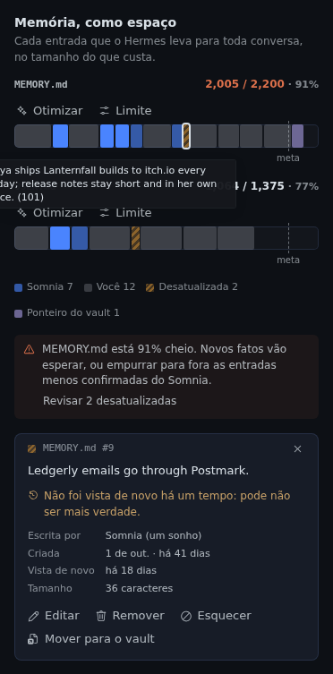

**Otimizar** reescreve um `MEMORY.md` ou `USER.md` cheio com menos caracteres e o mesmo comportamento. O modelo
propõe (encurtar, ou juntar entradas do mesmo assunto); o código recusa qualquer reescrita que perca ou invente um
número, caminho, comando, nome ou identificador; uma segunda leitura do modelo confere se o agente agiria igual.
Você marca o que aplicar, há backup e o *Desfazer* restaura. **Limite** aumenta o orçamento de caracteres do Hermes
para o arquivo e mostra quanto isso custa em tokens por conversa. Os dois também existem na CLI:
`hermes somnia optimize --target user`.

| | |
|---|---|
| 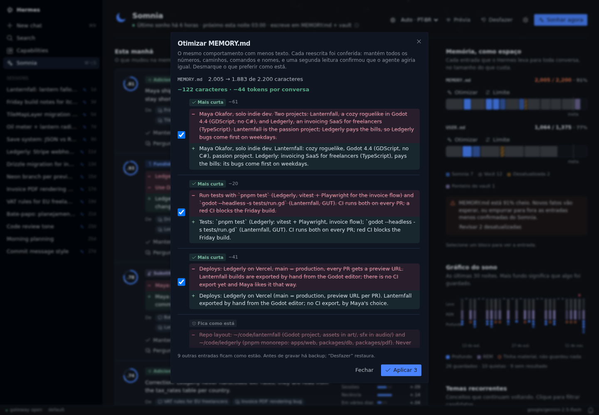 | 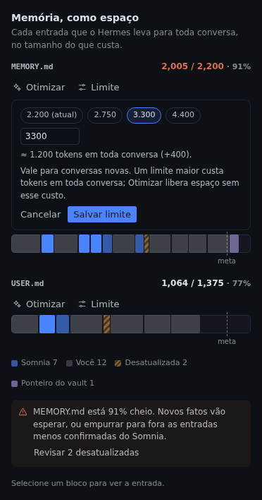 |

**Quase lá.** Os fatos que continuam voltando mas ainda não passaram em todos os filtros, e o que falta para cada
um. Fixe um para lembrar na próxima noite, ou promova na hora.

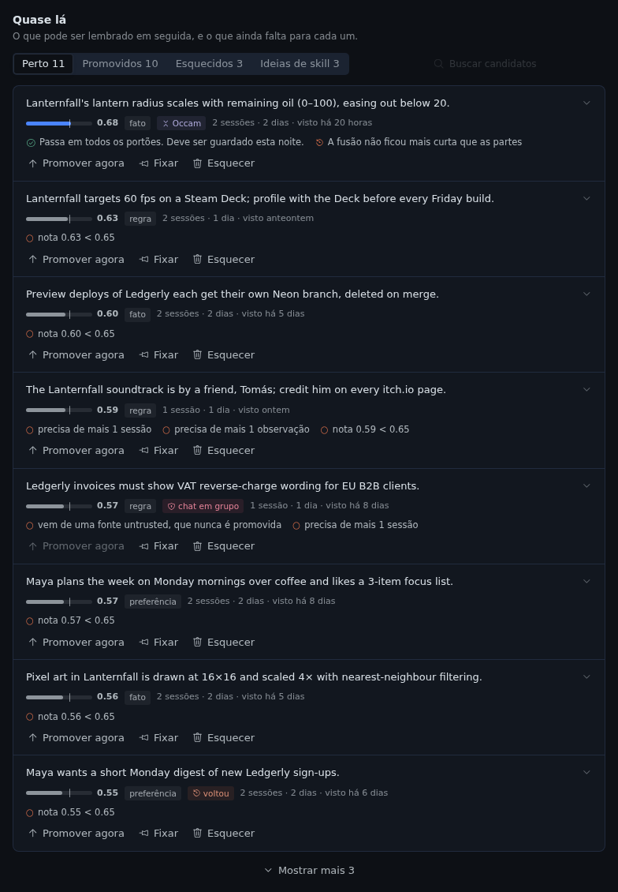

**Gráfico do sono e Diário de sonhos.** Uma barra por noite (mais funda quer dizer que algo foi guardado; um círculo
vazado quer dizer que havia material mas nada foi guardado) e o diário que o Somnia escreve toda noite.

| | |
|---|---|
| 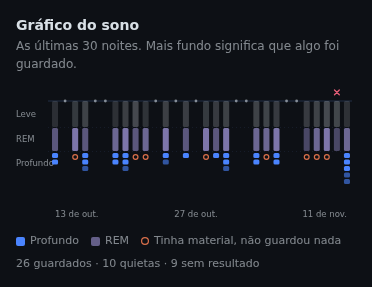 | 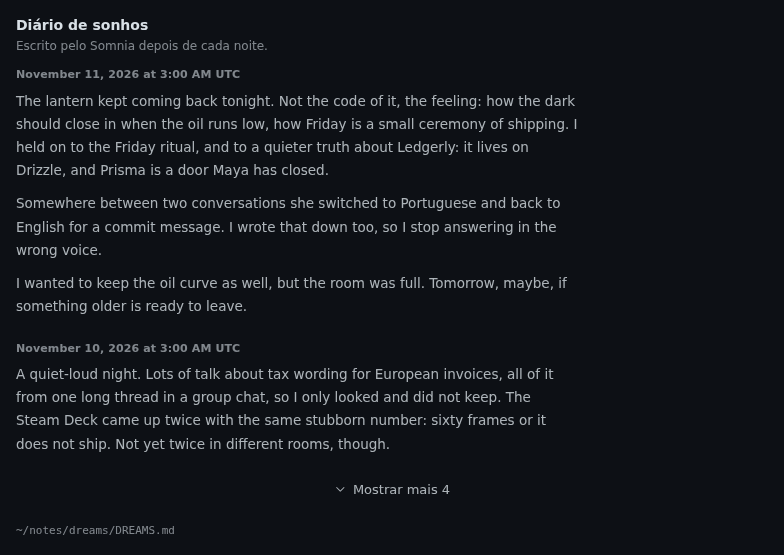 |

**Como o Somnia pensa.** Ligue e desligue princípios, escolha se as gravações entram direto ou esperam aprovação no
`/memory pending` e defina quantos fatos uma noite pode promover.

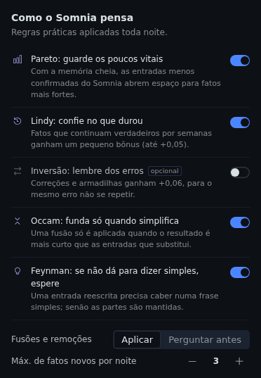

**Prévia de uma noite** antes de ela acontecer (nada é gravado; dá para cancelar a qualquer momento), um **cartão no chat** quando você pergunta ao Hermes
por que ele lembra de algo, e uma **página de configurações** em *Settings → Plugins → Somnia*.

| | |
|---|---|
| 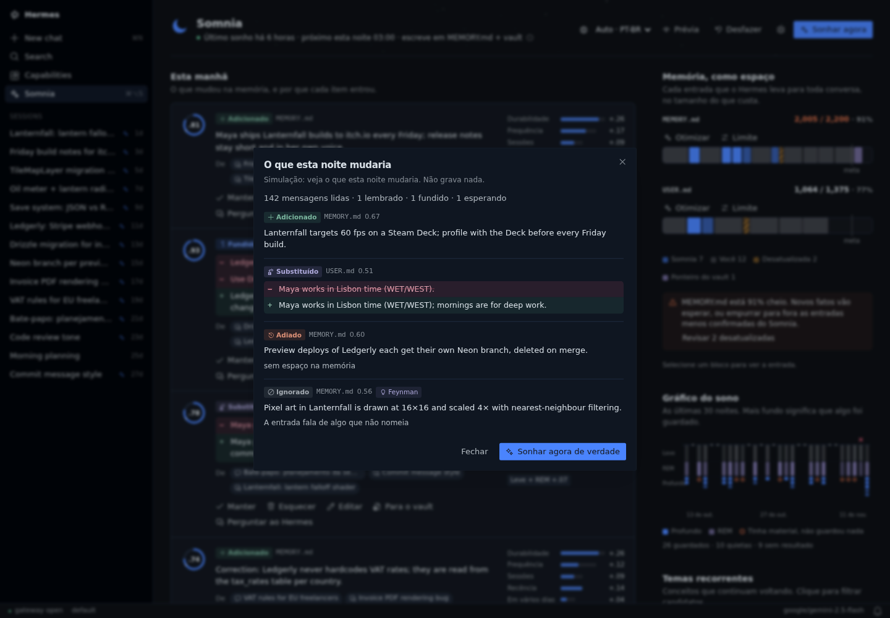 | 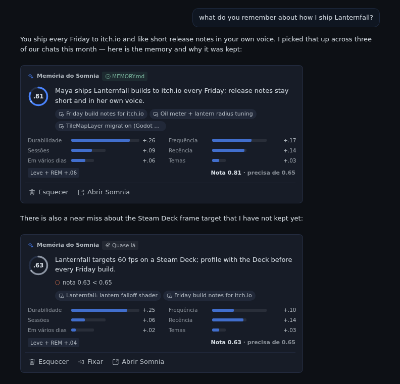 |
| 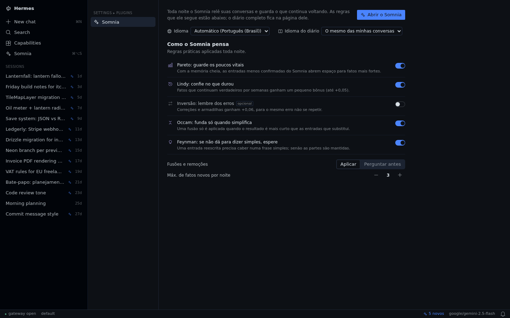 | 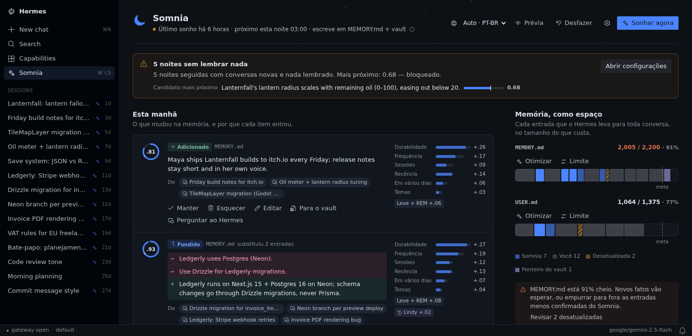 |

Tema claro: [screenshot](docs/screenshots/pt-BR/page-light.png). A página inteira: [screenshot](docs/screenshots/pt-BR/page-full.png).

## Idioma

- **Página:** English e Português (Brasil). O seletor fica no topo da página e na página de configurações.
  *Automático* segue o app do Hermes quando ele está num desses idiomas, depois o idioma do sistema, depois inglês.
  A escolha fica salva no seu computador.
- **Diário de sonhos:** `diary_language: auto` (padrão) escreve no idioma da maior parte das suas conversas. Coloque
  um nome ou código de idioma (`English`, `pt-BR`, …) para fixar. Também dá para mudar na página de configurações.
- **Entradas de memória** são escritas no idioma que você usou na conversa de onde elas saíram, ou no definido em
  `fact_language`.
- **CLI e logs** ficam em inglês.

Para adicionar um idioma basta uma tabela de tradução em `desktop/plugin.js` (a `EN` é a referência) e a linha dele
em `LANGUAGES`. Pull requests são bem-vindos.

## Instalação

No app desktop: **Capabilities → Plugins**, procure *Somnia* e clique em Install. Ou use o link no topo desta
página, ou o terminal:

```bash
hermes plugins install victorhurchella/hermes-somnia --enable
hermes somnia setup              # instala o job noturno (03:00, só script)
hermes somnia run --dry-run -v   # prévia de uma noite: nada é gravado
hermes somnia doctor             # confere se está tudo ligado
```

A página aparece na barra lateral, logo abaixo de **Capabilities**, quando o plugin está ligado. As configurações
ficam em *Settings → Plugins → Somnia*. Se o Hermes roda em outra máquina, instale pelo app desktop com o
componente Desktop marcado, para a página ser copiada para o seu computador.

Custo: o job noturno não tem turno de agente. As chamadas de LLM do Somnia passam pelo seu provedor do Hermes: uma
chamada de extração a cada ~20 mil caracteres de conversa nova (no máximo 12 por noite), uma de consolidação por
arquivo de memória que muda e uma para o diário. Uma noite sem conversa nova faz **zero** chamadas. Para usar um
modelo mais barato:

```yaml
# ~/.hermes/config.yaml
auxiliary:
  somnia:
    model: <um modelo barato do seu provedor>
```

## Comandos

| Comando | O que faz |
|---|---|
| `hermes somnia run [--dry-run] [-v] [--max-messages N]` | Roda uma noite agora (ou mostra a prévia) |
| `hermes somnia status` · `doctor` | Configurações, últimas noites, alarmes · checagem da instalação |
| `hermes somnia explain "<palavras>"` | Por que algo foi ou não lembrado: sinais, filtros, citações |
| `hermes somnia forget <key>` · `unforget <key>` | Esquece de vez (remove a entrada; nunca reaprende) · desfaz isso |
| `hermes somnia pin <key>` · `promote <key>` | Lembra na próxima noite mesmo sem repetição · agora mesmo |
| `hermes somnia optimize [--target user] [--apply]` | Propõe um `MEMORY.md`/`USER.md` mais curto que mantém todas as instruções (2 chamadas ao modelo; `--apply` grava as reescritas aprovadas nas checagens) |
| `hermes somnia undo` | Restaura `MEMORY.md`/`USER.md` de antes da última gravação (uma noite ou um Otimizar) |
| `hermes somnia diary` | O Diário de sonhos |
| `/somnia …` | O mesmo, de qualquer chat |

## Configuração

Tudo é opcional. Mude em *Settings → Plugins → Somnia*, na página do Somnia ou no `config.yaml`:

```yaml
plugins:
  entries:
    hermes-somnia:
      settings:
        destinations: auto               # auto | builtin | vault | both
        vault_path: ~/notes              # senão $OBSIDIAN_VAULT_PATH, senão $WIKI_PATH
        protected_paths: [self, journal] # o Somnia nunca escreve ali
        vault_note_type: inbox           # frontmatter das notas do inbox, para seguir o esquema do seu vault
        vault_note_tags: [somnia]
        vault_language: pt-BR            # en | pt-BR: títulos das notas do inbox
        vault_sync_command: ""           # ex.: git commit + push depois de cada noite ({note} {folder} {day})
        fact_language: auto              # ou English, pt-BR, ...: idioma em que os fatos são escritos
        principles: [pareto, lindy, occam, feynman]
        destructive: apply               # apply (como o OpenClaw) | stage (aprovar no /memory pending)
        max_promotions: 3
        diary_language: auto             # ou English, pt-BR, ...
        timezone: America/Sao_Paulo
```

| `destinations` | Onde o Profundo grava | Bom para |
|---|---|---|
| `auto` (padrão) | O vault, quando há um configurado (`vault_path`, `$OBSIDIAN_VAULT_PATH` ou `$WIKI_PATH`); senão `builtin` | Todo mundo |
| `builtin` | `MEMORY.md` / `USER.md`, dentro do limite de caracteres | Só a memória do prompt |
| `vault` | `<vault>/somnia/AAAA-MM-DD.md` (inbox, um checkbox por fato) + um ponteiro no `MEMORY.md` | Quem tem second brain |
| `both` | Os dois | Second brain mais uma memória de prompt que se cuida sozinha |

## Segurança

- **Lê só o que você disse.** Só as suas mensagens e as respostas finais do agente em sessões interativas. Saída de
  ferramentas, resultados de subagentes, sessões de cron e avisos do sistema nunca entram. Grupos não são
  confiáveis e nunca são promovidos. Segredos são mascarados antes de chegar ao modelo.
- **Evidência, não achismo.** Todo candidato traz uma citação literal da sua conversa. Se a citação não estiver lá
  de verdade, a nota do candidato cai.
- **Repetição, não casos isolados.** Um fato precisa de pelo menos 2 observações em pelo menos 2 sessões,
  durabilidade ≥ 0,5 e nota ≥ 0,65. As exceções são um "lembre disso" explícito seu, ou um fato fixado.
- **O modelo planeja, o código confere.** Um plano de consolidação é recusado se mexe em entradas desconhecidas,
  troca mais de 25% da memória, estoura o limite ou inventa números, caminhos ou URLs que não estão nas fontes. Uma
  operação que quebra um princípio ativo é adiada, não gravada.
- **Tudo é reversível.** As gravações passam pelo MemoryStore do próprio Hermes (trava, escrita atômica, checagem de
  injeção). Há backup antes de cada gravação e o `hermes somnia undo`. "Esquecer" é permanente: um fato esquecido só
  volta a ser sugerido se continuar aparecendo por 6 meses.

## O que ele acessa

- **Lê:** o banco de sessões do Hermes (`state.db`, só leitura), `MEMORY.md`/`USER.md`, `config.yaml`,
  `cron/jobs.json` (para achar o próprio job) e, no modo vault, a pasta do vault que você indicar.
- **Grava:** `MEMORY.md`/`USER.md` pelo MemoryStore do Hermes (ou na fila do `/memory pending` com
  `destructive: stage`), o próprio estado em `$HERMES_HOME/plugin-data/hermes-somnia/`, um backup antes de cada
  gravação, um job de cron (`hermes somnia setup`) e o script dele em `$HERMES_HOME/scripts/` e, no modo vault, só
  `<vault>/somnia/`. Ao mudar um **Limite** na página, `memory.memory_char_limit` / `memory.user_char_limit` no
  `config.yaml`, via `hermes config set`.
- **Chamadas ao modelo:** o seu provedor do Hermes (ou `auxiliary.somnia`). Os prompts têm trechos das suas
  mensagens e das respostas finais do agente, com segredos mascarados antes. Nenhuma outra chamada de rede, sem
  telemetria, sem credenciais.
- **Módulos internos do Hermes:** `tools.memory_tool` (gravação atômica com trava), `tools.write_approval` (fila de
  aprovação), `agent.auxiliary_client` (o modelo `auxiliary.somnia` no job noturno) e `hermes_cli.plugins_state`
  (salvar configurações pela página). Ainda não há API pública para eles. Cada um fica isolado em
  `hermes_somnia/hermes_api.py` e tem plano B.

## Documentação (em inglês)

- [docs/how-it-works.md](docs/how-it-works.md): o algoritmo do OpenClaw com referências arquivo:linha, e o que mudou
  para o Hermes e por quê.
- [docs/bench.md](docs/bench.md): o benchmark dos princípios.
- [docs/rpc.md](docs/rpc.md): o contrato entre a página do desktop e o Python.
- [dev/harness/README.md](dev/harness/README.md): rodar a página no navegador com dados de demonstração.
  `bash dev/harness/screenshots.sh` gera de novo todos os screenshots deste README, nos dois idiomas.

## Requisitos

Hermes Agent v0.23.1 ou mais novo, com a API de plugins (`register_cli_command`, `register_rpc`, jobs de cron só
com script). Linux ou macOS. Só a biblioteca padrão do Python.

```bash
cd tests && python3 -m unittest -v   # não precisa do Hermes
python3 bench/run.py                 # benchmark dos princípios (modo oráculo)
```

## Licença

MIT. Porta algoritmos, constantes e prompts do OpenClaw (MIT); veja o [NOTICE](NOTICE). Sem vínculo com o OpenClaw
ou a Nous Research. Os screenshots usam dados fictícios de demonstração.
